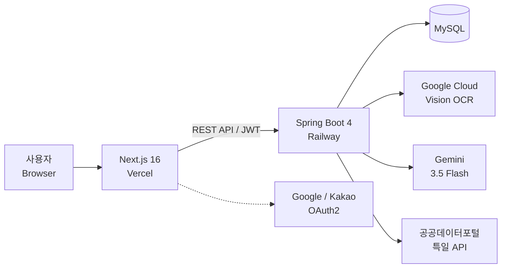
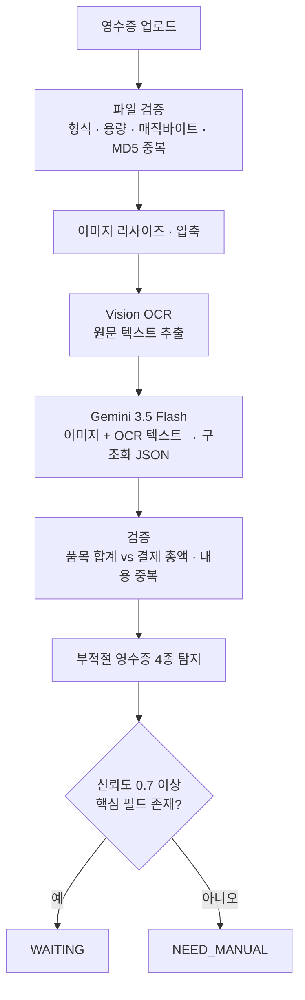
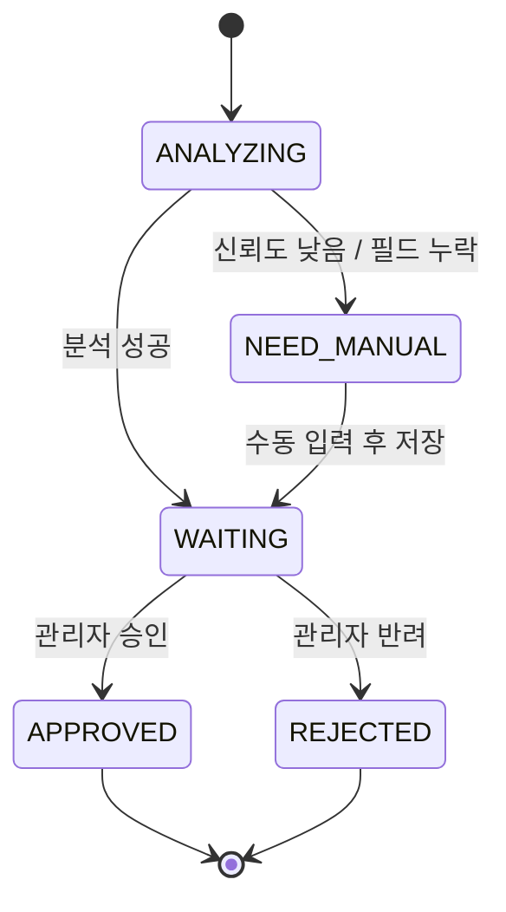
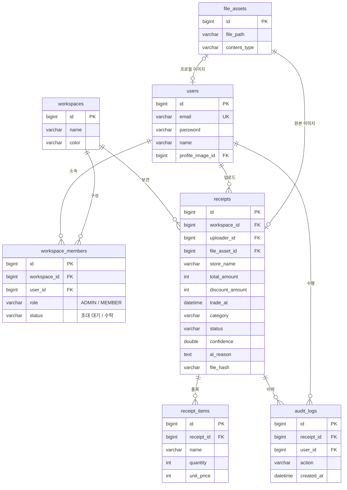
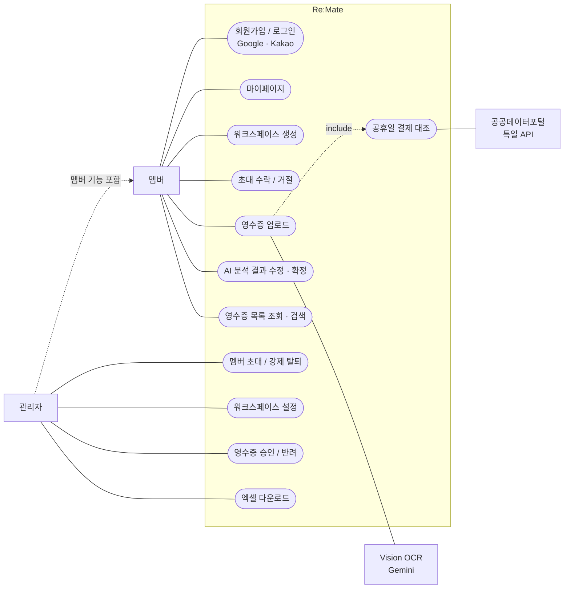

# Re:Mate

AI 영수증 자동 감사 및 팀 비용 관리 웹 서비스

영수증 사진 한 장으로 텍스트 추출, 지출 분류, 부적절 지출 탐지까지 처리하고 관리자는 승인/반려와 정산용 엑셀 출력만 하면 되는 서비스입니다.

배포 주소: https://re-mate.vercel.app


<br>

## 프로젝트 소개

동아리, 학생팀, 소규모 조직처럼 공식 회계 시스템이 없는 곳에서는 영수증을 종이로 보관하거나 카카오톡으로 주고받는 경우가 많습니다. 이 과정에서 증빙이 누락되고, 영수증 한 장씩 엑셀에 옮겨 적고 규정과 대조하느라 정산이 늦어지며, 심야·유흥·분할 결제 같은 부적절한 사용은 눈으로 걸러내기 어렵습니다.

Re:Mate는 이 문제를 세 가지로 풀었습니다.

- **사진 한 장으로 자동 입력**: Google Cloud Vision OCR과 Gemini가 가맹점, 금액, 결제일시, 품목을 추출하고 12종 지출 카테고리로 분류합니다.
- **부적절 영수증 4종 자동 탐지**: 심야 결제, 공휴일·주말 결제, 유흥업소 의심, 분할 결제를 등록 시점에 탐지해 태그와 판단 근거를 붙입니다. 최종 승인/반려는 관리자가 직접 결정합니다.
- **팀별 독립 워크스페이스**: 워크스페이스 단위로 영수증과 권한(ADMIN / MEMBER)을 분리하고, 정산용 엑셀을 일괄 다운로드할 수 있습니다.

<br>

## 프로젝트 정보

| 구분 | 내용 |
| --- | --- |
| 프로젝트 | 졸업 프로젝트 (캡스톤디자인) |
| 기간 | 2026.01.15 ~ 2026.06.03 |
| 팀명 | Sortify (5인) |
| 형태 | 반응형 웹 서비스 (Frontend / Backend 분리) |

<br>

## 팀원 및 역할

<table>
  <tr>
    <td align="center">
      <a href="https://github.com/kkw8989">
        <br>
        <b>김경우</b>
      </a><br>팀장 · Backend
    </td>
    <td align="center">
      <a href="https://github.com/OriginKim">
        <br>
        <b>김기원</b>
      </a><br>Backend
    </td>
    <td align="center">
      <a href="https://github.com/yogitzer">
        <br>
        <b>김무경</b>
      </a><br>Backend
    </td>
    <td align="center">
      <b>강민주</b><br>Frontend
    </td>
    <td align="center">
      <a href="https://github.com/LMS10">
        <br>
        <b>이민서</b>
      </a><br>Frontend
    </td>
  </tr>
</table>

### Backend

**김경우 (팀장)**
- 프로젝트 전체 일정 및 개발 방향 관리, 팀 회의 진행 및 회의록 작성·관리
- 백엔드 전체 구조 설계 및 계층 구조화, 기능 세분화 및 작업 분리·배분
- Swagger 문서 초기 구축 및 API 명세 정리
- REST API 설계 및 공통 요청·응답 구조 구성
- 전역 예외 처리 체계 및 TraceId 기반 로그 추적 시스템 구축
- 영수증 등록 및 파일 검증 기능 개발
- 보안 기반 파일 스토리지 시스템 및 이미지 서빙 엔드포인트 구축
- 감사 워크플로우 설계 및 동시성 기반 영수증 점유(Claim) 시스템 구축
- Google Vision API 연동 및 영수증 텍스트 추출 검증, CSV 내보내기 (김기원 공동)
- Render 배포 및 오류 분석

**김기원**
- OCR/AI 파이프라인 구축, 영수증 자동 인식 및 멱등성 기반 정산 시스템
- OCR 자동 추출 프로세스 및 상태 전이(FSM) 고도화
- AI 인식 정확도 개선 (9차 반복)
- 부적절 지출 탐지 로직 개발
- 성능 평가 파이프라인 구축
- 소셜 로그인 (Kakao OAuth2)
- Railway 클라우드 배포 구축

**김무경**
- 인증 및 유저 관리: 일반 회원가입, JWT 기반 인증, 소셜 로그인 (Google OAuth2)
- 워크스페이스 핵심 로직, 워크스페이스 진입 플로우 및 인증 예외 정책 수립
- 개인정보 및 비밀번호 관리 체계 고도화
- API 최적화 및 시스템 안정화
- OCR 기능 보완 및 오류 수정

### Frontend

**강민주**
- 와이어프레임 및 유저플로우 작성
- 공통 컴포넌트 개발
- 영수증 API 연결
- 프로젝트 데모 영상 제작

**이민서**
- 프로젝트 기획 상세 분석, 전체 화면 반응형 웹 UI/UX 기획 및 디자인
- 프로젝트 컨벤션 문서 작성
- 프로젝트 셋업 및 CI/CD 구축, 디자인 토큰 세팅, 라우팅 설정
- API 서비스 레이어 추상화 및 모듈화
- 공통 컴포넌트 및 전체 페이지 개발
- 발표자료 제작

<br>

## 시연 영상

[](https://youtu.be/VIDEO_ID)

<br>

## 주요 기능

### 워크스페이스

- 사이드바에서 소속된 워크스페이스를 오가며 팀별로 영수증을 독립 관리
- 워크스페이스 생성, 이메일 초대, 초대 수락/거절, 멤버 강제 탈퇴, 이름·색상 변경
- ADMIN / MEMBER 역할에 따라 라우트와 API 접근 권한 분리


### 영수증 업로드 및 AI 분석

- 드래그앤드롭 또는 파일 선택으로 단건/다중 업로드 (JPEG·PNG, 최대 10MB)
- 업로드 즉시 AI 분석 결과(가맹점, 금액, 결제일시, 품목, 카테고리)를 보여주고, 수정 후 저장 확정
- 신뢰도가 낮거나 핵심 필드가 비어 있으면 수동 입력 상태로 전환


### 영수증 상세 및 승인/반려

- 원본 영수증 이미지와 추출 데이터를 좌우로 나란히 배치해 바로 대조 가능
- AI 분석 태그와 판단 근거를 함께 표시
- 관리자는 승인/반려 처리, 모든 처리 이력은 감사 로그로 자동 기록


### 영수증 목록 및 엑셀 내보내기

- 가맹점명 검색, 상태·게시자 필터, 정렬, 페이지네이션
- 관리자는 전체 또는 선택한 영수증을 정산용 XLSX로 다운로드 (인원별·카테고리별 지출 요약, 의심 영수증 목록 포함)


<br>

## 기술 스택

| 구분 | 기술 |
| --- | --- |
| Frontend | Next.js 16 (App Router), React 19, TypeScript, Tailwind CSS v4, TanStack Query v5, NextAuth v4, Zustand, Framer Motion |
| Backend | Spring Boot 4 (Java 21), Spring Security, JWT, OAuth2 (Google / Kakao), JPA, MySQL, Gradle |
| AI | Google Cloud Vision OCR, Gemini 3.5 Flash |
| Infra | Vercel (Frontend), Railway (Backend), Docker |
| 협업 | GitHub, Notion, Figma, Swagger, Discord |

<br>

## 시스템 아키텍처 및 배포



프론트엔드는 Vercel, 백엔드는 Railway에 배포했습니다.

<br>

## AI 분석 파이프라인

OCR과 LLM을 결합해 단일 모델의 한계를 보완했습니다. Vision OCR이 원문 텍스트를 안정적으로 뽑고, Gemini가 이미지와 OCR 텍스트를 함께 받아 의미를 해석합니다. 응답 스키마(Response Schema)를 강제해 파싱 실패 없이 항상 정해진 JSON 구조를 받습니다.



- 추출 필드: 가맹점명, 총액, 결제일시, 품목(이름·수량·단가), 할인액, 카테고리, 신뢰도, AI 판단 근거
- 카테고리 12종: 식비, 교통, 회식/유흥, 사무용품, 숙박, 쇼핑, 행사/교육, 장비, 외주/용역, 선물/경조사, 의료, 기타
- 품목 합계와 결제 총액이 허용 오차(1~3%)를 넘게 어긋나면 신뢰도를 강제로 낮춰 수동 확인으로 보냅니다.
- 중복 제출은 파일 해시(MD5)와 OCR 내용(가맹점 + 금액 + 일시) 두 단계로 막고, `X-IDEMPOTENCY-KEY` 헤더로 중복 요청도 방지합니다.

### 영수증 상태 전이



<br>

## 부적절 영수증 탐지

AI는 의심 태그와 판단 근거만 제시하고, 최종 결정은 항상 관리자가 내립니다.

| 유형 | 탐지 방식 | 오탐 방지 |
| --- | --- | --- |
| 심야 결제 | 23시 ~ 익일 06시 결제 | 날짜 인식에 실패한 건은 판정에서 제외 |
| 공휴일·주말 결제 | 공공데이터포털 특일 API로 대조, API가 주지 않는 주말은 요일 계산으로 보완 | |
| 유흥업소 의심 | 상호명 키워드, 업종 분류, 품목(주류·담배 등) 3단계 교차 검증 | 홀세일, 헬스클럽 등 화이트리스트 예외 처리 |
| 분할 결제 | 30분 이내 다중 결제 + Levenshtein 유사도 75% 이상인 가맹점 | 이전에 등록된 영수증에도 소급 적용해 재태깅 |

<br>

## ERD



<br>

## 유스케이스



<br>

## 성능 평가

직접 수집한 영수증 200장에 정답(Ground Truth)을 라벨링해 기준으로 삼고, 1차부터 9차까지 같은 방식으로 측정하며 개선했습니다. 1~2차는 195건, 3차부터 200건 기준이라 차수 간 비교는 참고용입니다.

| 항목 | 1차 | 9차 (최종) |
| --- | --- | --- |
| 가맹점명 정확도 | 85.6% | 99.0% |
| 결제 총액 정확도 | 98.4% | 98.5% |
| 결제일시 정확도 | 95.8% | 96.0% |
| 품목명 / 수량 / 단가 | 87.8% / 84.8% / 83.0% | 90.6% / 90.1% / 86.5% |
| 유흥업소 탐지 정밀도 | 33.3% | 100.0% |
| 분할결제 탐지 정밀도 | 52.9% | 100.0% |
| 분할결제 탐지 재현율 | 69.2% (n=13) | 91.7% (n=36) |
| 자동 처리율 | 92.6% | 94.0% |

심야 결제(재현율 100%, n=9), 공휴일·주말 결제(96.8%, n=62), 유흥업소(재현율 100%, n=6)는 표본 수가 적은 항목도 있어 정밀도와 표본 수를 함께 표기했습니다. 테스트 영수증 199건 중 187건이 관리자 개입 없이 처리되었습니다.

**개선 과정**

- 1차에서 유사 가맹점 매칭과 복잡한 상호명의 인식률이 낮았고, 같은 매장 그룹의 첫 영수증에 소급 태깅이 빠지거나 상호명 특수문자로 매칭이 실패하는 사례를 찾아 로직을 보완했습니다.
- 3~8차에는 워터마크, 대표자명, 오인식 패턴이 발견될 때마다 프롬프트를 보완했고, 가맹점명 정확도가 93.9%에서 정체됐습니다.
- 9차에서 Gemini 2.5를 3.5 Flash로 교체하고 유사 글자 보정 규칙을 추가해 99.0%까지 끌어올렸습니다.
- 10차에서 이미지 전처리로 품목명 정확도 91.5%까지 올렸지만, 배포 환경에서의 안정성을 검증하지 못해 최종 코드에는 반영하지 않았습니다.

<br>

## 협업 방식

- Notion에 페이지·컴포넌트 단위로 요구사항 명세서를 작성하고, 프론트엔드/백엔드별 R&R과 일정을 관리
- 코드 스타일, 네이밍, 커밋 메시지 형식을 담은 프로젝트 컨벤션 문서 공유
- main 브랜치 직접 커밋 차단, `feat` / `fix` / `refactor` 기능 단위 브랜치에서 작업하고 PR 승인 후 Squash Merge
- GitHub Issue와 Project로 작업 현황 관리, Figma로 유저플로우·와이어프레임·디자인 토큰 관리, Swagger로 API 명세 공유
- 상태값, 에러코드, 카테고리 코드(12종), 부적절 사유 코드를 팀 공통 규칙으로 먼저 합의

<br>

## 실행 방법

### 사전 준비

- Java 21, Node.js, MySQL
- 환경 변수: DB 접속 정보, JWT 시크릿, Google Cloud Vision 인증 정보, Gemini API 키, Google·Kakao OAuth 클라이언트 정보, 공공데이터포털 API 키

### Backend

```bash
cd backend
./gradlew bootRun
```

### Frontend

```bash
cd frontend
npm install
npm run dev
```

<br>

## 회고 및 향후 계획

**아쉬운 점**

- 담배처럼 브랜드명이 복잡한 경우 단순 키워드 매칭의 한계가 있었음
- 훼손된 영수증을 위한 이미지 전처리(회전 보정, 대비 향상, 노이즈 제거) 연동을 완료하지 못함
- 영수증 원본에 카드번호나 서명이 있어도 마스킹 없이 그대로 저장됨
- 같은 조건에서도 AI 비결정성 때문에 일부 지표가 소폭 변동함
- 부적절 판정 기준이 모든 워크스페이스에 동일하게 고정되어 있음

**향후 계획**

- 유흥업소 키워드 사전을 지속적으로 보완
- 전처리 파라미터 튜닝과 배포 환경 안정성 검증 후 파이프라인에 통합
- 워크스페이스별 설정 화면에서 관리자가 판정 기준값을 직접 조정
- OCR 텍스트 위치 정보를 이용해 카드번호·서명 등 민감정보 영역 자동 블러
- 신뢰도를 더 세분화해 애매한 판정을 관리자에게 명확히 표시

<br>

## 문서

- [최종 발표 자료](docs/ReMate_최종발표.pdf)
